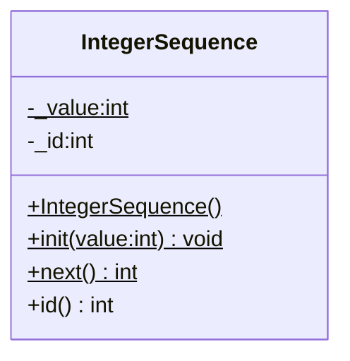

# Static Class Members

Normally, every object of a class has its own copy of the data members.
A **static member** belongs to the **class itself** and not to an
individual object.

* A **static data member** (class variable) exists **exactly once**,
    no matter how many objects of the class are created. All objects
    **share** the same variable.

* A **static member function** (class method) is called **without an
    object**. It has **no `this` pointer** and can therefore only access
    static members directly.

* Static members are accessed using the **scope resolution operator**
    `::` together with the class name, e.g. `IntegerSequence::next()`.

* Static members are still subject to **access control** (`private`,
    `public`, `protected`).

* The **lifetime** of a static data member is the whole program run,
    like a global variable. Its name, however, is placed in the
    **namespace of the class**, which avoids name clashes and
    allows hiding it behind `private`.


## Static Data Members

A static data member is **declared** inside the class using the keyword
`static`. Because the class declaration only describes the type, the
variable must also be **defined** (and initialized) exactly once in a
`.cpp` file. Note that the keyword `static` is **not repeated** in the
definition.

_Example_: Declaration of a class variable (`sequence.h`)
```C++
class IntegerSequence
{
private:
    static int _value;  // Static class variable
    int        _id;     // Instance variable

public:
    // Constructor
    IntegerSequence(void);

    // Static class methods
    static void init(int value);
    static int next(void);

    int id(void) const { return _id; }
};
```

_Example_: Definition of the class variable (`sequence.cpp`)
```C++
int IntegerSequence::_value = 0;  // Definition (only once!)
```

Forgetting the definition results in a **linker error**
(`undefined reference to IntegerSequence::_value`).

Since C++17, a static data member can be declared as `inline`. Then the
definition can be placed directly in the header file:

```C++
class IntegerSequence
{
private:
    inline static int _value = 0;
    // ...
};
```

**Constant** static members of integral type can be initialized
directly in the class. With `constexpr` this works for all literal
types:

```C++
class Buffer
{
public:
    static constexpr std::size_t CAPACITY = 64;

private:
    uint8_t _data[CAPACITY];
};
```


## Static Member Functions

A static member function is declared with the keyword `static` in the
class. Again, the keyword is **not repeated** in the definition.

_Example_: Implementation of static methods (`sequence.cpp`)
```C++
IntegerSequence::IntegerSequence(void)
{
    _id = IntegerSequence::next();
}

void IntegerSequence::init(int value)  // static
{
    _value = value;
}

int IntegerSequence::next(void)  // static
{
    return _value++;
}
```

Static methods are called via the class name. No object is needed:

```C++
IntegerSequence::init(1);

int value1 = IntegerSequence::next();  // 1
int value2 = IntegerSequence::next();  // 2
```

Each object created takes the next value of the shared sequence as its
`id`:

```C++
IntegerSequence obj1;   // obj1.id() == 3
IntegerSequence obj2;   // obj2.id() == 4
```

Because there is no `this` pointer, a static method **cannot access
instance members** directly:

```C++
int IntegerSequence::next(void)
{
    return _id;         // Error: no object available
}
```

Also, a static method cannot be declared `const` or `virtual`, since
both refer to an object.


### UML Class Diagram

In UML, static members are shown **underlined**.




## Use Cases for Static Members

### Object Counters and ID Generators

A class variable can count the number of created objects or generate
**unique IDs**, as shown in the `IntegerSequence` example.

```C++
class Sensor
{
private:
    inline static int _count = 0;
    int               _id;

public:
    Sensor() : _id(++_count) {}

    int id() const { return _id; }
    static int count() { return _count; }
};
```


### Class Constants

Values that are the same for all objects (e.g. buffer sizes, limits,
default values) are defined as `static constexpr` members. They need no
memory per object and can be evaluated at compile time, which is
important for **embedded systems**.

```C++
class Adc
{
public:
    static constexpr uint16_t MAX_VALUE   = 4095;   // 12 bit
    static constexpr float    REF_VOLTAGE = 3.3f;
};
```


### Static Creation Methods (Named Constructors)

Constructors in C++ always have the name of the class and can only be
distinguished by their parameter lists. A **static creation method**
(also called **named constructor** or **factory method**) is a static
method that creates and returns an object. It has several advantages:

* The method has a **meaningful name** that describes how the object
    is created.

* Different creation methods can have the **same parameter types**.

* The method can **validate** the arguments before an object is
    created.

* The constructor can be made `private`, so objects can **only** be
    created via the creation methods.

_Example_: Temperature with static creation methods
```C++
class Temperature
{
private:
    float _kelvin;

    // Private constructor
    explicit Temperature(float kelvin) : _kelvin(kelvin) {}

public:
    // Static creation methods
    static Temperature from_kelvin(float k)
    {
        return Temperature(k);
    }

    static Temperature from_celsius(float c)
    {
        return Temperature(c + 273.15f);
    }

    static Temperature from_fahrenheit(float f)
    {
        return Temperature((f - 32.0f) * 5.0f / 9.0f + 273.15f);
    }

    float kelvin() const { return _kelvin; }
};
```

```C++
Temperature t1 = Temperature::from_celsius(25.0f);
Temperature t2 = Temperature::from_fahrenheit(77.0f);
```

With `Temperature(25.0f)` it would not be clear whether Celsius,
Fahrenheit, or Kelvin is meant.


### Utility Functions

Functions that do not need any object state (e.g. conversions or
calculations) can be grouped as static methods in a class. Note that in
C++ a **namespace** is often the better choice for this purpose.

```C++
class Crc
{
public:
    static uint8_t crc8(const uint8_t* data, std::size_t length);
};
```


## Pitfalls

* Static data members are **shared state**. Changing them in one place
    affects all objects, which can make code harder to test (see
    `SetUp()` in `test.cpp`, which resets the sequence before each test).

* The **initialization order** of static objects in different
    translation units is not defined (**static initialization order
    fiasco**). Prefer `constexpr` or local static variables.

* Without synchronization, modifying static data from multiple threads
    or from an interrupt service routine leads to **race conditions**.


*Egon Teiniker, 2024-2026, GPL v3.0*
