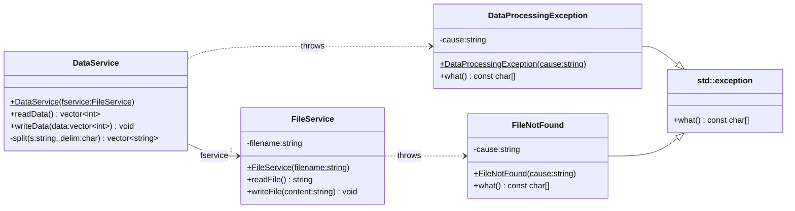

# Example: Exceptions - Data Service

This example shows how exceptions are used across **layers** of an
application. A low-level `FileService` reads a file, and a higher-level
`DataService` converts its content into a list of integers.

Each layer throws exceptions that match its **level of abstraction**:
The `DataService` catches the `FileNotFound` exception of the file layer
and throws its own `DataProcessingException` instead.

## Class Diagram



* `FileNotFound` and `DataProcessingException` inherit from
    `std::exception` and override `what()` to return the cause of the
    error.

* `DataService` uses a `FileService` to read the file. It does not own
    the `FileService` object, it only stores a pointer to it.

## Exceptions of the File Layer

`FileService` validates its input and reports file errors:

```C++
FileService::FileService(const string& filename)
{
    if (filename.empty())
    {
        throw invalid_argument("Invalid filename!");
    }

    _filename = filename;
}

string FileService::readFile() const
{
    if (!filesystem::exists(_filename))
    {
        throw FileNotFound("File " + _filename + " not found!");
    }

    ifstream file(_filename);

    if (!file)
    {
        throw runtime_error("File " + _filename + " cannot be opened!");
    }
    //...
}
```

| Situation                          | Exception               |
|------------------------------------|-------------------------|
| Empty filename                     | `std::invalid_argument` |
| File does not exist                | `FileNotFound`          |
| File exists but cannot be opened   | `std::runtime_error`    |

## Exception Translation in the Data Layer

A client of `DataService` should not need to know that the data comes
from a file, or how the values are parsed. Therefore, `readData()`
**translates** all low-level exceptions into a `DataProcessingException`:

```C++
vector<int> DataService::readData() 
{
    try
    {
        string      content = _fservice->readFile();
        vector<int> data;

        for (const string& line : split(content, '\n'))
        {
            if (line.empty())
            {
                continue;   // Skip empty lines
            }

            for (const string& value : split(line, ','))
            {
                data.push_back(stoi(value));
            }
        }

        return data;
    }
    catch (const FileNotFound& e)
    {
        throw DataProcessingException(e.what());
    }
    catch (const logic_error&)  // invalid_argument, out_of_range from stoi()
    {
        throw DataProcessingException("Invalid value in data file!");
    }
}
```

| Low-level exception                          | Cause                   |
|----------------------------------------------|-------------------------|
| `FileNotFound`                               | File does not exist     |
| `std::invalid_argument` (from `std::stoi()`) | Value is not a number   |
| `std::out_of_range` (from `std::stoi()`)     | Value too large for int |

All of them are reported as `DataProcessingException`. This way, the file
layer could later be replaced (e.g. by a network or flash memory service)
without changing the exception handling of the clients.

## Tests

_Example:_ Verify that the exception is translated

```C++
TEST_F(FileServiceTest, InvalidDataFileTest) 
{
    service = new FileService("xxxx.txt");
    dataService = new DataService(service);
    
    // Verify
    EXPECT_THROW(dataService->readData(), DataProcessingException);
}
```

The path to `data.txt` is passed to the tests by CMake as an absolute
path, so the tests can be started from any directory:

```cmake
target_compile_definitions(test PRIVATE
    DATA_FILE="${CMAKE_CURRENT_SOURCE_DIR}/data.txt")
```

Further test data (multiple lines, invalid values) is written to
temporary files using `testing::TempDir()`.

*Egon Teiniker, 2024-2026, GPL v3.0*
