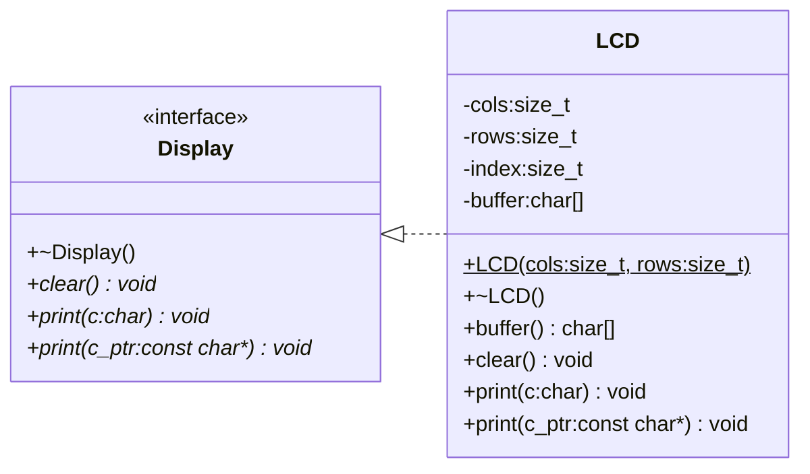

# Example: Interface - LCD Inheritance

This example shows how an **abstract base class** can be used as an
**interface** in C++. The `Display` class only declares pure virtual
functions, and the `LCD` class provides the implementation.

## Class Diagram



* `Display` is marked as `<<interface>>` because it contains only pure
    virtual functions (shown in italics) and no data.
    It cannot be instantiated.

* `LCD` **realizes** the interface (dashed arrow with a hollow head) and
    overrides all pure virtual functions.

* `LCD` stores its characters in a dynamically allocated `_buffer` of
    size `_cols * _rows`. The buffer is allocated in the constructor and
    released in the destructor (RAII).

Note that `char*` is written as `char[]` in the diagram: In Mermaid, a
trailing `*` marks a member as abstract, so `char*` would be rendered as
an abstract member of type `char`.

## Implementation

_Example:_ Interface declared as an abstract base class

```C++
class Display 
{
public:
    virtual ~Display(void) {};      // Destructor

    // Pure virtual Methods
    virtual void clear(void) = 0;
    virtual void print(char c) = 0;
    virtual void print(const char * c_ptr) = 0;
};
```

The **virtual destructor** is important: When an `LCD` object is deleted
through a `Display*` pointer, the destructor of `LCD` is called as well,
and the buffer is released.

_Example:_ Derived class implementing the interface

```C++
class LCD : public Display
{
private:
    size_t _cols;
    size_t _rows;
    size_t _index;
    char*  _buffer;
 
public:
    LCD(size_t cols, size_t rows);  // Constructor
    ~LCD(void);                     // Destructor

    // Accessors
    char* buffer(void) const { return _buffer; }

    // Methods
    void clear(void) override;
    void print(char c) override;
    void print(const char * c_ptr) override;
};
```

## Polymorphism

Client code can use the `Display` interface without knowing the concrete
class:

```C++
TEST(LCDTestGroup, PolymorphismTest) 
{
    // Setup
    Display* display = new LCD(40, 2);  // Upcast: inherently safe
    display->clear();
    
    // Exercise
    display->print("Hallo!");

    LCD* lcd = dynamic_cast<LCD*>(display); // Explicit Downcast
    
    // Verify
    ASSERT_NE(nullptr, lcd);
    EXPECT_STREQ("Hallo!", lcd->buffer());
    
    // Teardown
    delete display;
}
```

* **Upcast** (`LCD*` to `Display*`): Always safe, because an `LCD`
    "is a" `Display`.

* **Downcast** (`Display*` to `LCD*`): Must be checked at runtime using
    `dynamic_cast<>`, which returns `nullptr` if the object is not an
    `LCD`.

*Egon Teiniker, 2024-2026, GPL v3.0*
