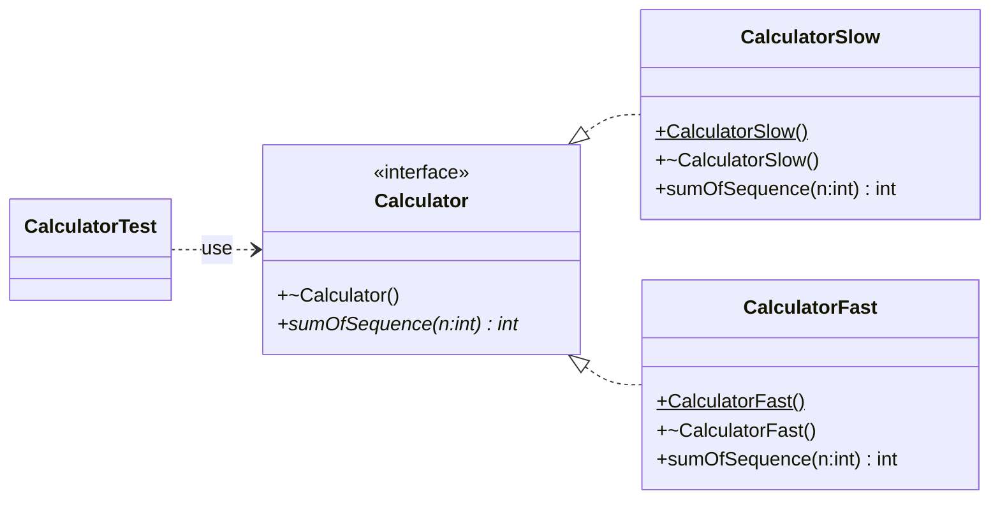

# Example: Interface - Sum of Sequence

This example shows how an **interface** allows different implementations
of the same functionality to be exchanged. The `Calculator` interface
declares a method to calculate the sum of the sequence `1 + 2 + ... + n`.
Two classes implement this method with different algorithms.

## Class Diagram



* `Calculator` is marked as `<<interface>>` because it contains only a
    pure virtual function (shown in italics) and no data.
    It cannot be instantiated.

* `CalculatorSlow` and `CalculatorFast` **realize** the interface (dashed
    arrows with a hollow head) and override `sumOfSequence()`.

* `CalculatorTest` (the client) only **uses** the `Calculator` interface
    (dashed arrow). It does not depend on a concrete implementation.

## Implementation

_Example:_ Interface declared as an abstract base class

```C++
class Calculator // Interface 
{
public:  
    virtual ~Calculator(void) {}

    virtual int sumOfSequence(const int n) = 0;
};
```

The **virtual destructor** ensures that the destructor of the derived
class is called when an object is deleted through a `Calculator*`
pointer.

_Example:_ Slow implementation using a loop, runtime **O(n)**

```C++
int CalculatorSlow::sumOfSequence(const int n)
{
    int result = 0;

    for(int i = 1; i <= n; i++)
    {
        result += i;
    }

    return result;
}
```

_Example:_ Fast implementation using the Gauss formula, runtime **O(1)**

```C++
int CalculatorFast::sumOfSequence(const int n)
{
    return n * (n + 1) / 2;
}
```

Both implementations return the same result, but `CalculatorFast` needs
only a constant number of operations, independent of `n`.

## Polymorphism

Client code only depends on the `Calculator` interface. The concrete
implementation can be exchanged without changing the client code:

```C++
TEST(CalculatorTest, CalculatorSlowTest)
{
    // Setup
    Calculator* calc = new CalculatorSlow();    // Upcasting
    
    // Exercise + Verify
    EXPECT_EQ(1+2+3+4+5, calc->sumOfSequence(5));

    // Teardown 
    delete calc;
}
```

Replacing `new CalculatorSlow()` with `new CalculatorFast()` is the only
change needed to use the other algorithm.

* **Upcast** (`CalculatorFast*` to `Calculator*`): Always safe, because a
    `CalculatorFast` "is a" `Calculator`.

* **Downcast** (`Calculator*` to `CalculatorFast*`): Must be checked at
    runtime using `dynamic_cast<>`, which returns `nullptr` if the object
    is not a `CalculatorFast`.

```C++
TEST(CalculatorTest, DynamicCastTest)
{
    // Setup
    Calculator* calc = new CalculatorFast();                    // Upcasting
    CalculatorFast* fast = dynamic_cast<CalculatorFast*>(calc); // Downcasting
    
    // Verify
    ASSERT_NE(nullptr, fast);
    EXPECT_EQ(1+2+3+4+5, fast->sumOfSequence(5));

    // Teardown 
    delete calc;
}
```

*Egon Teiniker, 2024-2026, GPL v3.0*
