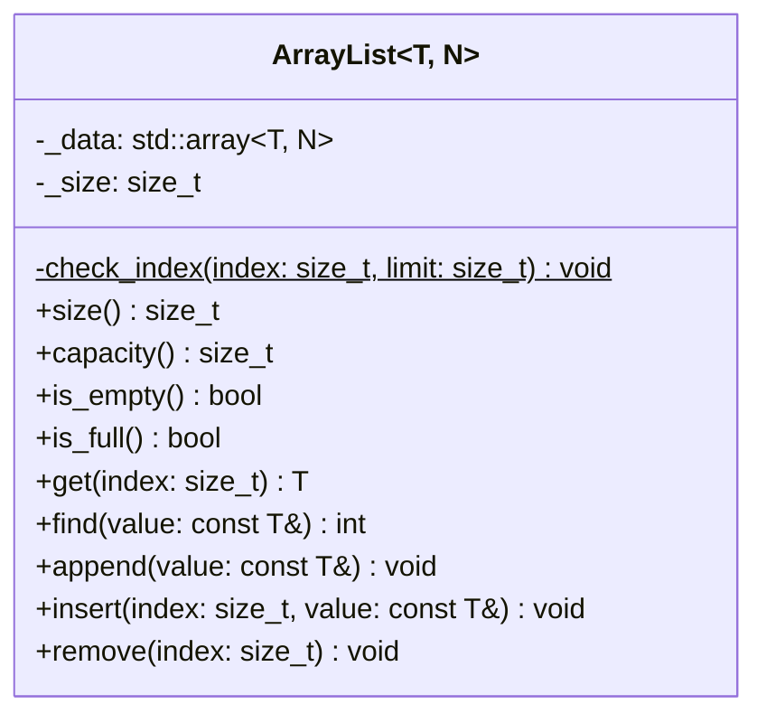

# Example: ArrayList Template

An `ArrayList` stores elements in a contiguous block of memory. Compared to
a linked list, the key benefits are:

* **O(1) random access**: any element is reached directly via its index
    without traversal.
* **Better cache performance**: contiguous memory layout means elements
    are loaded together into CPU cache lines, making iteration faster.
* **Lower memory overhead**: no per-node pointers are needed; only the
    array itself and one bookkeeping integer are stored.

The trade-off is that `insert` and `remove` require shifting elements,
which is O(n) in the worst case.

This version is a **class template** parameterized by the element type `T`
and the capacity `N`. Every combination of `T` and `N` produces a distinct
type, e.g. `ArrayList<int, 16>` or `ArrayList<std::string, 4>`.


## Class Diagram




## Implementation

The class template takes a type parameter `T` and a non-type parameter `N`.
The elements are stored in a `std::array<T, N>`, so the storage size is
fixed at compile time and no heap allocation is needed:

```cpp
template <typename T, size_t N>
class ArrayList
{
    private:
        std::array<T, N> _data{};
        size_t _size = 0;
    // ...
};
```

Because the storage is a member object, the class needs neither a
constructor nor a destructor. The compiler-generated versions are
sufficient, and no resource can leak. This makes the template a good fit
for embedded systems, where dynamic memory is often avoided.

The capacity is the template parameter itself:

```cpp
size_t capacity() const { return N; }
```

**Bounds checking** is done by a private static helper which terminates
the program if an index is out of range:

```cpp
static void check_index(size_t index, size_t limit)
{
    if (index >= limit)
    {
        fprintf(stderr, "Index out of bounds\n");
        exit(EXIT_FAILURE);
    }
}
```

**Searching** (`find`) compares elements with `==`, so `T` must provide
an equality operator. It returns the index of the first match or `-1`:

```cpp
int find(const T& value) const
{
    for (size_t i = 0; i < _size; i++)
    {
        if (_data[i] == value)
        {
            return static_cast<int>(i);
        }
    }
    return -1;
}
```

**Insertion** (`insert`) shifts all elements from `index` onwards one
position to the right to open a slot, then writes the new value:

```cpp
void insert(size_t index, const T& value)
{
    check_index(index, _size + 1);

    for (size_t i = _size; i > index; i--)
    {
        _data[i] = _data[i - 1];
    }
    _data[index] = value;
    _size++;
}
```

**Removal** (`remove`) shifts all elements after `index` one position
to the left to close the gap:

```cpp
void remove(size_t index)
{
    check_index(index, _size);

    _size--;
    for (size_t i = index; i < _size; i++)
    {
        _data[i] = _data[i + 1];
    }
}
```

Since a template is instantiated at compile time, its complete definition
must be visible to the compiler. Therefore, the whole implementation is
placed in the header file `array_list.h` and there is no `.cpp` file.


## Usage

```cpp
ArrayList<int, 16> numbers;
numbers.append(1);
numbers.append(5);
numbers.insert(1, 3);       // [1, 3, 5]

ArrayList<std::string, 4> names;
names.append("Homer");
names.append("Bart");
int index = names.find("Bart");     // 1
```


*Egon Teiniker, 2024-2026, GPL v3.0*
